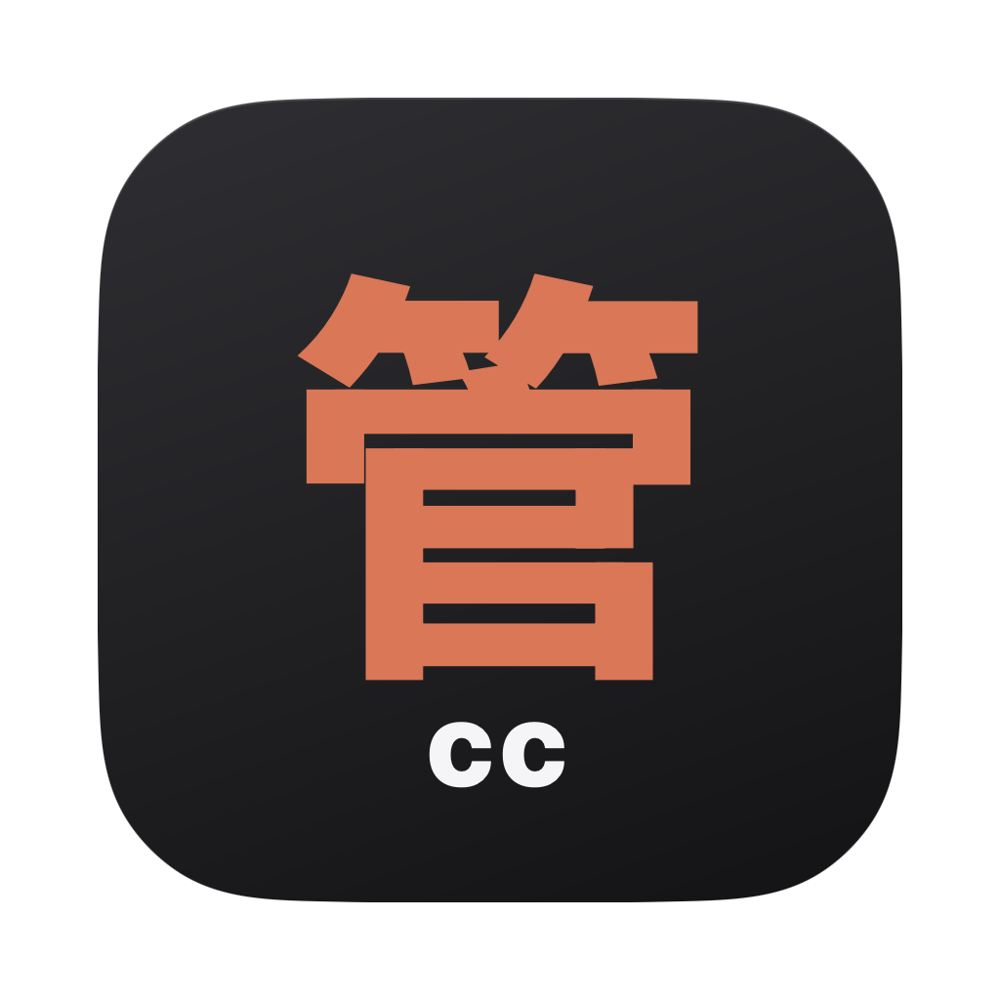
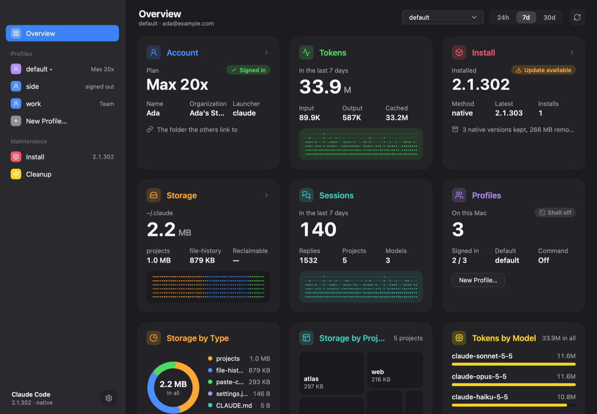
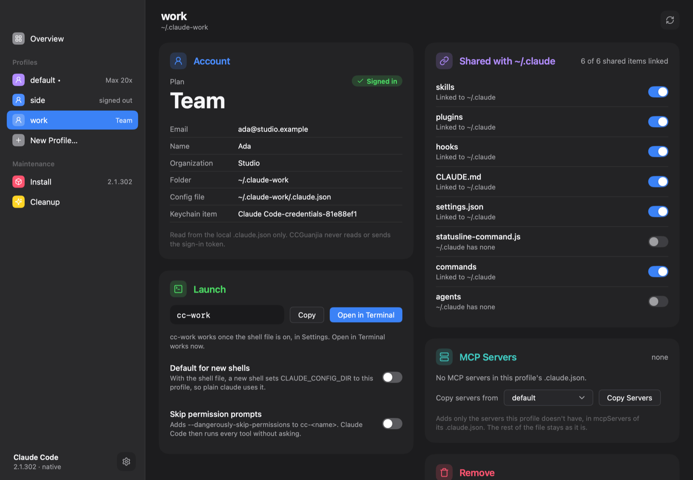
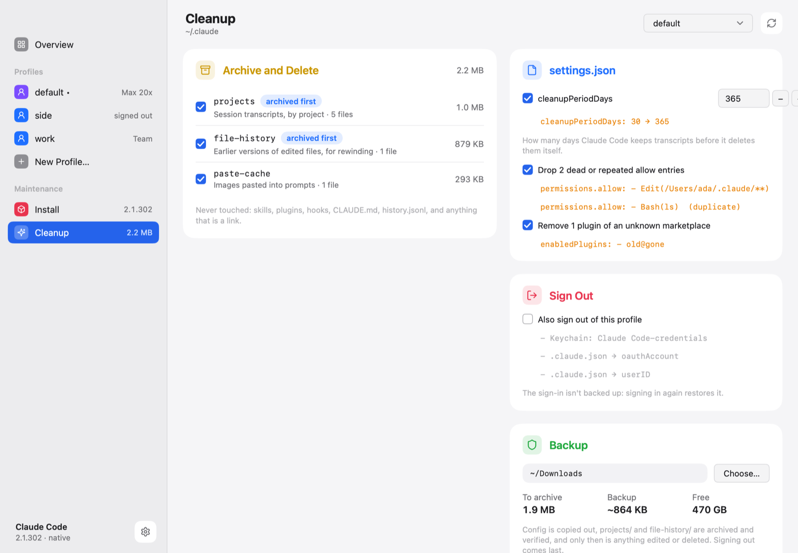
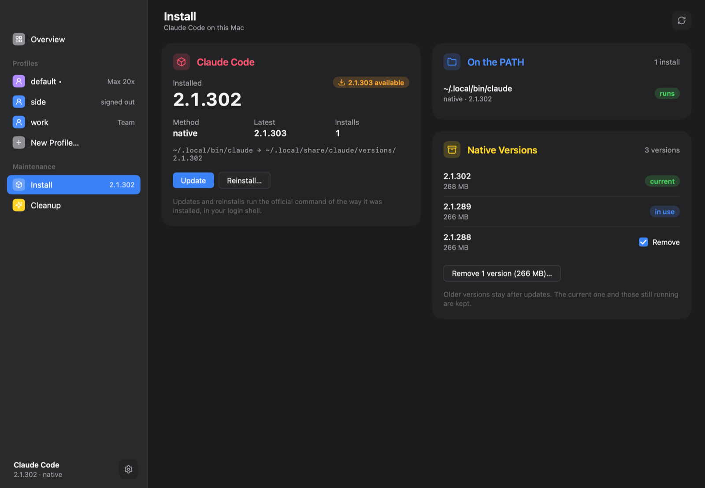

<p align="center">
  
</p>

<h1 align="center">CCGuanjia</h1>

<p align="center">管家 (a steward): a small Mac app that looks after Claude Code. It keeps the profiles of your own
accounts, shows what they use and how Claude Code is installed, and cleans up their folders after backing them up.
It is written in Go and draws its own window with <a href="https://github.com/egoist/mygo">MyGo</a>.</p>

<p align="center">
  
  
  <a href="LICENSE"></a>
</p>

<p align="center">
  
</p>

## Features

- **Profiles.** Every `~/.claude-<name>` folder is a profile with its own sign-in and history, which Claude Code uses
  through its own `CLAUDE_CONFIG_DIR`. CCGuanjia finds the ones you already have and shows each one's account, plan
  and sign-in, read from the local `.claude.json`.
- **Shared configuration.** A new profile links skills, plugins, hooks, `CLAUDE.md`, `settings.json`, the status
  line, commands and agents to `~/.claude`. Each link has its own switch, and a file of the profile's own is never
  replaced. MCP servers copy from one profile to another.
- **Launching.** Start a profile with `cc-<name>` from the shell file, with **Open in Terminal** (Terminal, iTerm or
  Ghostty), or with `ccgj run <name>`. Each one runs on its own sign-in, with the `ANTHROPIC_*` variables that would
  point it elsewhere cleared. Your own lines in `~/.zshrc` stay as they are: CCGuanjia adds one line that sources
  its own file.
- **Overview.** Tokens, sessions and models from the transcripts over 24 hours, 7 days or 30 days, what each folder
  takes by type and by project, and how Claude Code is installed.
- **Install.** Finds the native installer, npm, Homebrew or Bun, and updates or reinstalls through that method's
  official command. It warns when there are several installs or `claude` is a shell function, and removes the native
  installer's old versions that are neither current nor running.
- **Cleanup.** The order of `clean-claude.ts`: copy the configuration out, archive `projects/` and `file-history/`,
  verify the archives, and only then edit `settings.json` and delete. Each item and each settings edit is a check box
  with its diff. Signing out is optional, comes last, and needs the profile's name typed.
- **`ccgj`**, also `ccguanjia`: `list`, `run`, `use`, `default`, `dir`, `new` and `open` from a terminal.
- English and Simplified Chinese.

## Tour

<table>
  <tr>
    <td width="50%"><b>A profile</b>: its account, how to start it, and what it shares with ~/.claude<br>
      <a href="docs/screenshots/profile-dark.png"></a></td>
    <td width="50%"><b>Cleanup</b>: archive and verify, then delete, with each settings edit shown<br>
      <a href="docs/screenshots/cleanup-light.png"></a></td>
  </tr>
  <tr>
    <td><b>Install</b>: the install that runs, updates, and old native versions<br>
      <a href="docs/screenshots/install-dark.png"></a></td>
    <td></td>
  </tr>
</table>

## Within Anthropic's rules

CCGuanjia is for managing **your own** accounts on **your own** Mac, such as a personal plan beside a work one,
using only what Claude Code itself provides:

- It never reads, copies or sends a sign-in token. It asks the Keychain only whether an item is there (`security
  find-generic-password` without `-w`), and signing out deletes the item without reading it. The usage it shows comes
  from local transcripts, not from Anthropic's servers.
- It changes nothing about where you appear to be or what device you appear to use: no fingerprinting, no
  timezone or region changes, and no proxies.
- It never switches accounts by itself, for example to get around usage limits.

Follow Anthropic's [Consumer Terms](https://www.anthropic.com/legal/consumer-terms) and
[Usage Policy](https://www.anthropic.com/legal/aup) for each account you use. CCGuanjia is not made by or
affiliated with Anthropic.

## Requirements

- macOS 13 or later
- Go 1.27 or later, to build it

## Getting started

```sh
go run ./cmd/ccguanjia            # run the app
go run ./cmd/ccguanjia cli list   # the ccgj command, from source
go tool mygo build                # build build/darwin-arm64/CCGuanjia.app and a .dmg
```

In the app, **Settings → Shell file** adds the `cc-<name>` functions to new shells, and **Settings → ccgj command**
installs `ccgj` and `ccguanjia` in `~/.local/bin`:

```sh
ccgj list                 # profiles, plans and sign-ins
ccgj new work             # ~/.claude-work, linking the shared items
ccgj run work             # Claude Code with the work profile (or: cc-work)
ccgj use work             # switch this shell to it
ccgj default work         # new shells start with it
```

See [CONTRIBUTING.md](CONTRIBUTING.md) to test, build and release.

## License

[MIT](LICENSE)
